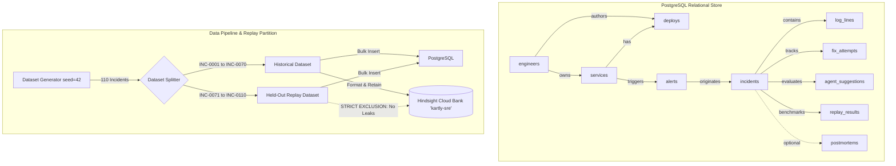
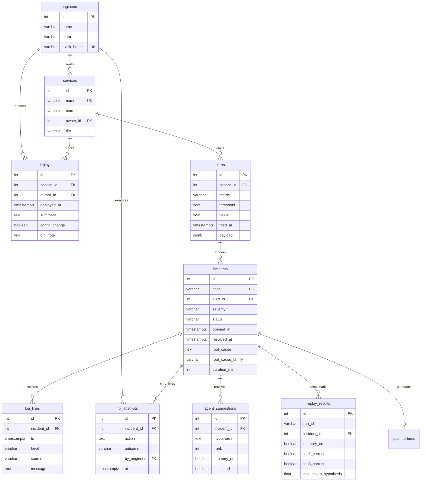

# RecallOps — Data Architecture & Operational Pipeline
**Author:** Member 3 (Database & Data Engineering)  
**Target Roles:** Entire RecallOps Team  
**Version:** 1.0.0  

---

## 1. System Overview

RecallOps pairs an operational relational database (PostgreSQL) with a long-term semantic memory engine (Hindsight Cloud) to provide SRE agents with contextual recall of recurring failure patterns.



---

## 2. Entity-Relationship Model



---

## 3. Recurring Root-Cause Families

The synthetic dataset implements 8 recurring failure patterns grounded in real-world distributed systems:

| Family Key | Description | Primary Services | Metric Signature | Authentic Log Sources | Typical Failed Fix | Ground-Truth Worked Fix |
|---|---|---|---|---|---|---|
| `db_pool` | Connection pool exhaustion | `checkout-api`, `inventory-svc`, `payments-svc` | `db_connection_pool_active_ratio > 0.90` | `HikariCP`, `PostgreSQL` | Restart application pods | Increase pool size to 65 & fix connection leak |
| `redis_eviction`| Eviction storm under flash sale | `inventory-svc`, `search-svc`, `checkout-api` | `redis_memory_usage_ratio > 0.85` | `RedisServer`, `CacheManager` | Flush Redis cache | Upgrade to r6g.2xlarge (32GB) & switch to MessagePack |
| `tls_expiry` | Expired ingress or mTLS cert | `payments-svc`, `checkout-api`, `delivery-eta-svc`| `cert_expiry_seconds < 86400` | `NginxIngress`, `CertManager` | Disable HTTP/2 | Re-issue cert via cert-manager & reload Envoy |
| `payment_timeout`| Payment gateway latency & drops | `payments-svc`, `checkout-api` | `payment_gateway_failure_rate > 0.05` | `PyRazorpay`, `PaymentEngine` | Increase HTTP timeout to 60s | Route traffic to fallback gateway (PayU/HDFC) |
| `feature_flag` | Malformed config / unhandled None | `checkout-api`, `search-svc`, `inventory-svc` | `http_5xx_error_rate > 0.02` | `UnleashSDK`, `CheckoutController`| Restart deployment | Toggle flag OFF in Unleash console |
| `disk_full` | Logrotate failure / disk 100% | `search-svc`, `notification-svc`, `delivery-eta-svc`| `disk_partition_used_ratio > 0.85` | `SystemdJournal`, `Logrotate` | Restart application | Fix logrotate cron, purge debug logs, resize EBS |
| `n_plus_one` | Lazy loading query regression | `search-svc`, `checkout-api`, `inventory-svc` | `database_cpu_utilization > 0.80` | `SQLAlchemyLogger`, `PostgreSQL`| Horizontally scale pods | Rewrite query with eager loading (`joinedload`) |
| `kafka_lag` | Consumer lag / rebalance storm | `notification-svc`, `delivery-eta-svc` | `kafka_consumer_group_lag > 10000` | `KafkaConsumer`, `KafkaBroker` | Kill/restart consumer pods | Increase `max.poll.interval.ms` & scale pods |

---

## 4. Hindsight Memory Retention Protocol

### Template Architecture
Memories retained in Hindsight Cloud follow a standardized, token-efficient structure:

```text
[INC-0001]
[checkout-api]
[family: db_pool]

Symptom:
Alert fired for db_connection_pool_active_ratio (value: 0.985, threshold: 0.90).

Deployment:
Deployment 'perf(db): tune pool size' was pushed (config_change=True).

Failed fix:
Restarted service deployment pods (connections exhausted again within 2 minutes)

Outcome:
FAILED.

Root cause:
HikariCP connection pool exhausted due to unclosed database connections during peak traffic surge.

Successful fix:
Increased RDS Postgres max_connections to 400 and tuned HikariCP maximumPoolSize to 65

Outcome:
WORKED.

Resolution time:
35 minutes.
```

### Context Tags
Each memory unit in Hindsight is indexed with:
- `INC-xxxx` (Incident Code)
- Service name (e.g. `checkout-api`)
- `family:<family_key>` (Root-cause classification)
- `severity:<P1..P4>` (Criticality)
- `historical_incident` (Partition flag)

---

## 5. Evaluation Separation & Held-Out Partition

To maintain strict scientific validity:
- **Historical Partition (INC-0001 to INC-0070):** 70 incidents loaded into PostgreSQL AND retained into Hindsight bank `kartly-sre`.
- **Held-Out Replay Partition (INC-0071 to INC-0110):** 40 incidents loaded into PostgreSQL for replay evaluation, but **strictly excluded from Hindsight memory**.
- **Agent Evaluation Loop:** During replay, Member 4's AI/ML harness queries Hindsight for memories matching the symptom of incident `INC-xxxx`. Because the incident itself was never seen by Hindsight, the agent must recall analogous historical incidents (from INC-0001 to INC-0070) that share the root-cause family and recommend the successful fix while warning against the failed fix.
